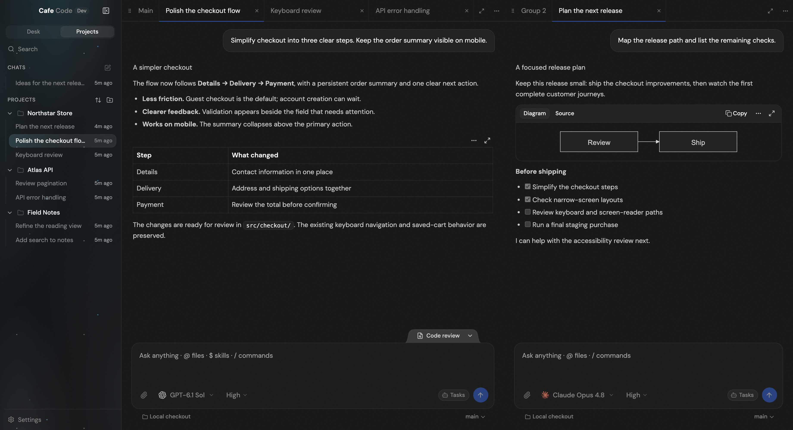

# Cafe Code

コーディングエージェントと、落ち着いて作業するためのデスクトップアプリ。
Codex、Claude、OpenCode、Grok Build、Axiom をひとつの場所で使えます。
プロジェクトのチャットも、フォルダーを選ばず始めるチャットも、タブと分割ペインで整理できます。

Made in Japan with love. [English](README.md)



_現在のソース版 UI に、架空のプロジェクトと会話を表示しています。
使える機能はプロバイダーによって異なります。ソース版には最新リリースより新しい変更が含まれる場合があります。_

## ダウンロードとインストール

[GitHub Releases](https://github.com/cafeai/cafe-code/releases/latest) からデスクトップ版をダウンロードできます。

| 環境                 | ダウンロード       | インストール                                             |
| -------------------- | ------------------ | -------------------------------------------------------- |
| macOS・Apple Silicon | arm64 DMG          | DMG を開き、Cafe Code を Applications にドラッグします。 |
| macOS・Intel         | x64 DMG            | DMG を開き、Cafe Code を Applications にドラッグします。 |
| Windows・x64         | EXE インストーラー | 現在のユーザー用にインストールします。                   |
| Linux・x64           | AppImage           | 実行権限を付けて起動します。                             |

macOS リリースは Developer ID で署名し、公証しています。
Windows と Linux の配布物は未署名です。Windows では発行元や SmartScreen の警告が表示される場合があります。
各リリースには `SHA256SUMS.txt` が付属します。
ほかの Linux 形式・アーキテクチャはローカルビルド用で、公開リリースの配布対象には含まれません。

配布版は更新を確認しますが、ダウンロードとインストールはユーザーの操作で行います。
Windows と対応する AppImage ではアプリ内から更新できます。
macOS の **0.2.0 までのリリース**は DMG での手動更新が必要です。
現在のソースでは、対応を有効にした署名済みパッケージにアプリ内更新を追加しています。
ソース版はパッケージ用アップデーターではなく Git ブランチの更新情報を使います。
詳しくは[リリースと更新](docs/desktop-releases-and-updates.md)を参照してください。

Cafe Code は開発中です。CI には macOS・Windows・Linux の品質チェックとネイティブ配布物の確認がありますが、
個々の OS・プロバイダーの検証範囲は異なります。インストールする版のリリースノートも確認してください。
古いレジストリ配布パッケージはデスクトップ版より遅れているため、リリース版かソース版を使ってください。

## プロバイダーの設定

入力欄、または **Settings → Providers** でアカウントとモデルを選びます。
使いたいプロバイダーだけ準備すれば大丈夫です。
Cafe はそれぞれのアカウントと、プロバイダー本来の権限管理を使います。

| プロバイダー | 準備                                                                                       | 主な対応                                                                                       |
| ------------ | ------------------------------------------------------------------------------------------ | ---------------------------------------------------------------------------------------------- |
| Codex        | [Codex CLI](https://developers.openai.com/codex/cli) を導入し、`codex login`。             | スキル、サービスティア、ネイティブコードレビュー、サブエージェント履歴。                       |
| Claude       | [Claude Code](https://claude.com/product/claude-code) を導入し、`claude auth login`。      | メッセージ配信・タスク制御、選択メッセージからの分岐、スラッシュコマンド。                     |
| OpenCode     | [OpenCode](https://opencode.ai/docs/) と上流プロバイダーを設定、または既存サーバーに接続。 | ローカル実行とサーバー接続。別ホストのサーバーにはファイルアクセスの制限があります。           |
| Grok Build   | [Grok Build](https://docs.x.ai/build/overview) を導入し、`grok login`。                    | Early Access の ACP 対応。[設定と制限](docs/grok-build.md)。                                   |
| Axiom        | ネイティブ AxiomCLI または Axiom アプリを導入し、必要なら Cafe の **Log In**。             | ACP、アカウントに紐づく履歴、応答と attestation の検証。[設定ガイド](docs/axiom-provider.md)。 |

Windows インストーラーは、確認済みの **Node/Codex/Claude オフライン実行環境**を準備できます。
システムの PATH は変更しません。認証は別途必要です。
それ以外のインストール方法では、使いたいプロバイダーのツールを別途導入します。
[Windows の同梱実行環境](docs/desktop-releases-and-updates.md#windows-managed-providers)を参照してください。

## できること

- **作業を整理。** [Desk のタブと分割ペイン](docs/desk-tabs.md)、Projects の保存済み一覧、
  リポジトリ不要の[単独チャット](docs/standalone-chats.md)を使えます。
  待機中の Codex/Claude チャットは履歴付きで複製できます。作業ファイルは共有されます。
- **入力を止めずに作業。** プロンプトをキューに入れ、未送信分を編集し、対応するプロバイダーでは実行中に追加指示できます。
  計画、ツールの動き、[サブエージェントの履歴](docs/subagent-activity.md)を確認できます。
- **あとで実行。** Codex・Claude・Grok の **Tasks → Scheduled** で一度だけ、または繰り返しの作業を設定できます。
  エージェントの提案は承認するまで実行されません。実行には担当バックエンドの稼働と、起きているコンピューターが必要です。
  [スケジュールのガイド](docs/scheduled-followups.md)。
- **ファイルと豊かな表示。** [ファイル添付とキュー編集](docs/file-attachments.md)、
  拡大・パンできる[画像](docs/inline-images.md)、[Mermaid 図と図・表の PNG 出力](docs/mermaid-diagrams.md)、
  [数式](docs/markdown-math.md)に対応しています。
- **操作できる図。** Full access の Codex/Claude セッションでは、対応する MCP Apps を含む
  [ライブ可視化](docs/agent-visualizations.md)を表示できます。
  権限を持つブラウザーコードを実行するため、ガイドの条件と制限を確認してください。
- **声で下書き。** 入力欄の音声入力と、macOS の任意設定の[グローバル音声入力](docs/global-dictation.md)があります。
  別途 OpenAI API キーと API クレジットが必要です。
- **使用量を確認。** [Usage と Atrium](docs/usage-statistics.md) でトークン、コスト品質、生成時間を確認できます。
  通常の金額は API 料金換算の推定で、サブスクリプションの請求額ではありません。
  Axiom は取得できたネイティブ確定料金を使います。
- **別の端末から接続。** ブラウザー Web UI と、Connections のペアリングによる保存済みサーバー接続があります。
  SSH・Tailscale トンネルは作成しません。[LAN・HTTPS・接続設定](docs/remote-environments.md)。
- **言語と外部ツール。** **Settings → Appearance → Language** で英語・日本語・韓国語を選べます。
  ローカルプロジェクトは、導入済みエディター、ファイルマネージャー、外部ターミナルで開けます。

## ソースから動かす

[`.node-version`](.node-version) に記載された正確な Node.js LTS、Corepack、環境に合ったネイティブビルドツールを用意してください。
非 LTS の Current は使いません。Yarn は Corepack 経由で固定しています。
macOS では Swift を含む Xcode Command Line Tools が必要です。

```bash
git clone https://github.com/cafeai/cafe-code.git
cd cafe-code
corepack enable
corepack yarn install --immutable
corepack yarn build:desktop
corepack yarn workspace @cafecode/desktop start
```

start はビルド済み出力を起動するコマンドです。ソース変更後は再ビルドしてください。
詳しい前提条件は[ソース開発ガイド](docs/source-development.md)にあります。

## ローカル開発

依存関係とビルドツールの準備後、変更を監視する開発環境を起動できます。

```bash
corepack yarn dev:desktop
```

ビルド済みチェックアウトで localhost 限定のデバッグエンドポイントを使う場合:

```bash
corepack yarn start:desktop:debug
```

デバッグモードで起動すると URL を表示します。
開発環境と通常のビルド済みアプリは、既定のポートと状態保存先が異なります。
LAN ポートの開放は[接続ガイド](docs/remote-environments.md#lan-access-and-firewall-ports)、
外部 MCP クライアントの認証は [MCP ガイド](docs/cafe-mcp.md#external-mcp-clients)を参照してください。

必要な検証は次の順です。macOS/Linux では重い検証を `nice -n 10` で起動し、
既存のワーカー数・メモリー上限を維持してください。テスト後の強制デスクトップビルドを最後に行います。

```bash
corepack yarn fmt
corepack yarn lint
corepack yarn typecheck
corepack yarn test
corepack yarn build:desktop --force
```

型チェック専用の CI メモリー設定は[ソース開発ガイド](docs/source-development.md#verification)、
ローカル Arch/Debian ビルドと AUR 保守は [Linux パッケージガイド](docs/linux-packaging.md)にまとめています。
ほかの機能別ガイドは [English README の一覧](README.md#guides)から参照できます。

## Cafe Code について

Cafe Code は [T3 Code](https://github.com/pingdotgg/t3code) から始まった fork です。
速さ、信頼性、安全性、わかりやすい動きを大切にしています。
チャットして、作業を見て、邪魔しない。エディターとコンソールは、使い慣れたものを隣に置いてください。
アプリ内ターミナルやコードエディターはありません。

変更を提案する前に [Contributing](CONTRIBUTING.md) を確認してください。

<p align="center">
  
</p>

## ライセンス

[AGPL-3.0-or-later](LICENSE) です。上流への帰属表示は [NOTICE.md](NOTICE.md) に残しています。
