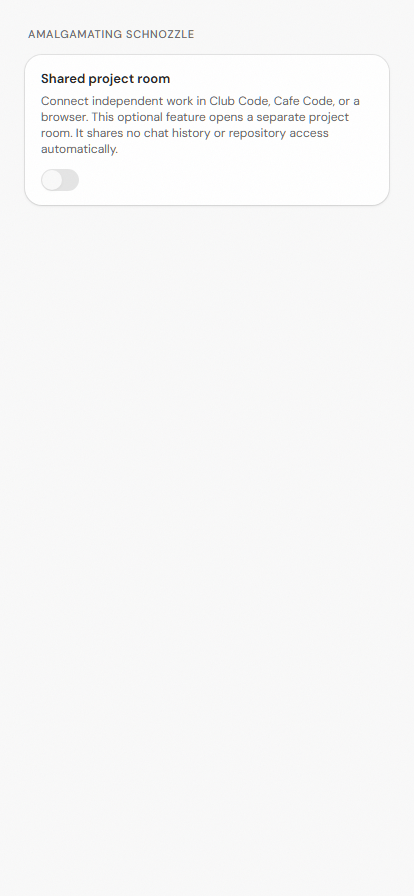
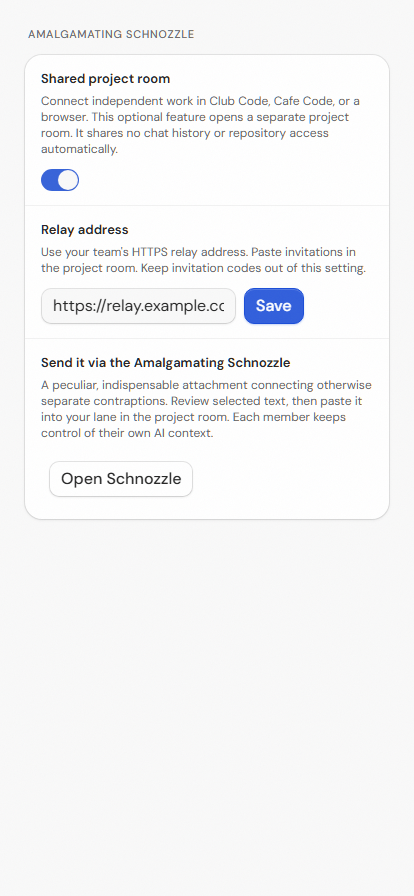

# Optional Amalgamating Schnozzle connector

Teams can use a separate shared project room while keeping their Cafe Code conversations and repository permissions independent. The room also works in a browser for a teammate without GitHub access.

Enable **Settings → Connections → Amalgamating Schnozzle**, save the team's HTTPS relay origin, then select **Open Schnozzle**. The option defaults to off. It adds a sidebar shortcut and uses the existing external-link bridge to open the system browser. It does not embed remote content in the desktop renderer or start a background relay inside Cafe Code. Disabling the option removes the shortcut; an already open browser room remains independent.

“Send it via the Amalgamating Schnozzle” — a peculiar, indispensable attachment connecting otherwise separate contraptions.

Review selected text before copying it into the room. A device-bound invitation belongs in the room's join form, never in the relay-address setting. The connector rejects credentials, query strings, fragments and paths in that setting. It accepts HTTPS origins and HTTP loopback origins for development only. No provider token, backend owner token, full transcript or repository credential is exported.

The companion relay and browser application are maintained in [Club Code's Schnozzle directory](https://github.com/John-Ryan21337/club-code/tree/dbf1a69e70ffa1a21ed21812dea5ec9718f288ee/scripts/schnozzle). They use outbound HTTPS, one-use invitations, independent work lanes, durable offline queues and version-bound project decisions. The current relay is trusted with shared content; direct peer transport and end-to-end encryption are not implemented. Decisions in the room do not authorize a merge, deployment or tool call in Cafe Code.

The connector is intentionally independent of the relay implementation and has no new runtime dependency. The same origin opens from Cafe Code, Club Code, or a normal browser. It uses standard client-settings persistence and the existing settings and sidebar components. The native integration has browser tests for default-off behavior, explicit opening, URL validation, and persistence of a credential-free origin.

The initial UI is shown with the option disabled and enabled:

