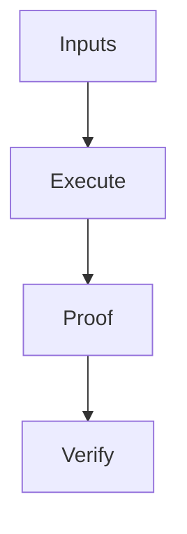
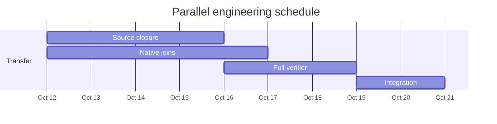

# Mermaid diagrams in chat

Last updated: 2026-10-23 09:31:33 JST (UTC+0900)

Cafe renders closed code fences labeled `mermaid`. The first line inside the
fence declares the diagram type: for example, `flowchart TD` means a top-to-bottom
flowchart. The `flowchart` declaration is part of Mermaid, not a replacement for
the fence's language label.

````markdown

````

Supported families are flowcharts (`flowchart`/`graph`), sequence diagrams,
class diagrams, state diagrams, entity-relationship diagrams, XY charts
(`xychart`/`xychart-beta`, bar and line plots), pie charts (`pie`, including
`showData`), and bounded ordinary Gantt schedules (`gantt`). Additional native
families include journey, quadrant charts, requirements, Git graphs, mind maps,
timelines, Sankey, block/packet diagrams, Kanban, architecture, radar, treemap,
swimlanes, use cases, event modeling, Venn, fishbone, Wardley and Cynefin diagrams.
C4 context/container/component/dynamic/deployment views, tree views, agent flows
and native/EBNF/ABNF/PEG railroad diagrams are also admitted within their bounds.
Use the pinned library's declarations (`journey`, `quadrantChart`,
`requirementDiagram`, `gitGraph`, `mindmap`, `timeline`, `sankey-beta`,
`block-beta`, `packet`/`packet-beta`, `kanban`, `architecture-beta`, `radar-beta`,
`treemap-beta`, `swimlane-beta`, `usecase-beta`, `eventmodeling`, `venn-beta`,
`ishikawa`/`ishikawa-beta`, `wardley-beta`, `cynefin-beta`, `C4Context`,
`C4Container`, `C4Component`, `C4Dynamic`, `C4Deployment`, `treeView-beta`,
`agentflow-beta`, `railroad-beta`, `railroad-ebnf-beta`, `railroad-abnf-beta`,
`railroad-peg-beta`). `info` renders the pinned version label. Ordinary code
blocks are unchanged. Untagged diagrams, unsupported families, incomplete fences,
invalid syntax, and diagrams exceeding resource limits remain copyable source.
XY charts support category or numeric X axes, named plots, optional point labels
and horizontal orientation. Pie charts retain small entries in the legend even
when the pinned renderer omits their slices below 1% from the drawing.

Gantt schedules support section headings, status tags (`active`, `done`, `crit`),
explicit or sequential task IDs, and multiple earlier `after` dependencies.
Use `dateFormat YYYY-MM-DD` for calendar dates and an optional `axisFormat`, such
as `%b %d`. Positive integer durations use `w`, `d`, `h`, `m`, `s` or `ms`.
Explicit end dates require that date format; `inclusiveEndDates` and earlier
`until` references retain the native engine's semantics. Without `dateFormat`,
the pinned engine interprets ISO start dates in UTC, rather than the local
calendar used with an explicit format. Cafe does not rewrite either spelling.

````markdown

````

## Controls and streaming

- **Diagram / Source** switches between the image and original Mermaid DSL.
- **Copy** copies that DSL, without adding fences or altering its contents.
- **Expand** opens a larger view with Fit, Reset, zoom, scrolling and pointer
  panning. Unmodified arrows on the focused viewport scroll in bounded instant
  steps; selected text, descendant controls and modified shortcuts retain their
  behavior. Escape closes it and restores keyboard focus.
- **⋯ Image actions** offers **Copy image** and **Save as PNG**, in the inline
  toolbar and expanded viewer. Copy writes an actual PNG image and confirms
  with a brief toast; the existing Copy button still copies the original DSL.
  Save opens the desktop's native destination picker, or downloads a PNG in a
  browser. Successful saves and cancellation are quiet.

Image export captures the complete diagram at intrinsic resolution, irrespective
of scroll position, Fit or zoom. The opaque background matches its rendered theme.
Images beyond the shared bitmap budget are proportionally reduced, never cropped.
The limits are defined in `packages/contracts/src/imageExport.ts`. An incomplete,
failed or still-changing themed diagram cannot export an image; Source remains
available. A browser without image clipboard permission/support can still save
as PNG. Browser download dispatch is not a receipt that the OS wrote the file.

Markdown tables have the same three-dot image menu in both views. Full-content
exports preserve text, table borders, code, emphasis, link labels and rendered
math, using bundled local typefaces. App-owned decorative file icons use local
File/Folder glyphs; ordinary embedded images must already be decoded and readable
without a new fetch. Unsupported, unreadable or oversized content fails visibly
instead of producing a silently incomplete table. Export never follows links,
replays provider work, reads the clipboard or sends content to a remote renderer.
See the [image export decision](decisions/diagram-table-image-export.md) for
resource, publication, lifecycle and verification boundaries.
Their expanded viewport uses the same focused arrow-scroll behavior as diagrams,
without consuming cell-text selection or descendant control keys.

Diagrams render as soon as their own closing fence arrives, even while later
prose is still streaming. Unclosed fences stay source even in truncated history.
Long diagrams scroll within a bounded preview; they do not widen the chat or
shrink vertically into unreadable thumbnails. Controls follow Cafe's theme and
interface scale. Screen-reader labels use Mermaid `accTitle`/`accDescr` when
present, with Source always available as a text alternative.

The shared renderer also covers authored plans and subagent output. No provider
calls, extra inference tokens, transcript migration, or network diagram service
are involved. Old messages render when reopened.

## Deliberate limits

Rendering uses the local, pinned full Mermaid12.0.0 single-script build, without
lazy network-loaded engines. HTML labels, source-supplied
configuration/frontmatter, click/link directives, and image nodes are not enabled.
The source remains available when these constructs cannot be rendered. SVG is
sanitized separately and displayed as an image; it cannot become active chat DOM.
User-supplied animation, filters and layout CSS do not survive output admission.

Every native family has explicit parsed-data admission. Packet bit offsets and
block spacer/column spans are bounded before parsing because their grammars
expand shorthand during parsing. Packet fields must be contiguous and positive;
the first field may share the header line and receives the same preparse checks.
Rows plus fragments must fit the250-item budget. Hierarchies must be finite,
bounded and acyclic. Sankey networks must be acyclic with positive finite flows;
links use native source-node solid colors rather than unsupported gradients.
Radar domains/curves and treemap values must produce finite nondegenerate scales.
Architecture admits only its bundled cloud/database/disk/internet/server/blank
icons, counts layout hints and bounds the native queue walk before layout.
External icon packs, architecture iconText, custom mind-map icons, C4 sprites,
Kanban ticket links and use-case JSON table flattening remain source-only.
Venn diagrams have at most eight circles, with bounded finite overlaps and
synthesized pairwise work. Railroad finite repetition/separator constructs remain
source because the pinned native renderer omits those authored semantics.
Event modeling's native HTML-only labels use a narrow opaque-frame adapter:
only the fixed native box/name/data structure becomes inert SVG text, retaining
characters and breaks, with bounded font fitting (16px down to8px, at most2x
horizontal compression). Unknown markup, overfull labels, multiline data blocks
and native-unused note/given-when-then declarations remain source. Inline data
uses braces with whitespace before the closing brace; other spellings remain
source because the pinned engine can truncate the last payload character.
Unknown/forward event dependencies remain source because the native one-pass
resolver omits them. No HTML or foreignObject is enabled in the chat image policy.
Wardley coordinates follow
the native percentage contract, including the library's normalized source
spelling; Cafe never rescales or rewrites stored source. New graph-layout families
also cap aggregate minimum-rank spans to prevent dummy-node amplification.
Recursive trees/grammar expressions have a64-level depth bound. These are
conservative fidelity/resource limits, not transcript changes or replacement DSLs.
The `info` renderer's exact version-label output receives its native fixed
400×100 viewport because upstream omits the viewBox; arbitrary viewport synthesis
and unknown output contracts are not enabled.

Sources are limited to 32 KiB UTF-8, with at most 250 parsed nodes and 250 parsed
connections/messages per graph (state/class auxiliary items count too). XY charts
count categories/numeric ticks plus series against the node limit, and aggregate
plotted points and aggregate retained point labels each against the connection
limit. Pie charts count every parsed section, including zero or tiny entries.
Numeric data must be finite, within the final axis domains, and produce finite
nonempty tick/angle calculations. Empty/all-zero pies, charts without plots and
unsafe numeric ranges fall back to source. Results
are limited to 2 MiB SVG. One job runs at a time per app window, with at most 64
pending identities, and an in-memory 128-entry / 16 MiB cache. Cache entries bind
the complete source, theme, library version and policy. Nothing is persisted in
local storage or transmitted to a provider.

Gantt counts tasks, section headings and bounded calendar-axis ticks together
against the 250-item limit, and counts all predecessor references separately
against the 250-connection limit. Authored dates must be real Gregorian dates in years
1000–9999, task durations must be positive, and both individual durations and
the whole schedule must fit within 3,660 elapsed days. Custom `tickInterval`
values use a positive integer no greater than 250 and a supported native unit;
admission conservatively counts base calendar intervals, including intervals
whose fields reset each month or year. Dense axes therefore remain source even
when a large interval multiplier appears to reduce their ticks.

Gantt exclusions/includes, forward or missing dependencies, duplicate/reserved
identities, ambiguous numeric section headings, repeated tags, unsupported date formats, `topAxis`, and custom
`todayMarker` styles remain copyable source. `todayMarker off` is supported.
Milestones also remain source: the pinned engine requires CSS transforms that
Cafe deliberately strips, so rendering them as ordinary squares would be
misleading. These are conservative fidelity and resource limits, not changes to
the stored chart or an expansion of the SVG security policy.

An asynchronous 15-second deadline releases stalled jobs. It is not a hard CPU
deadline: a sandboxed iframe is not guaranteed a separate browser thread, and a
timer cannot preempt synchronous layout. Source and parsed-graph bounds therefore
apply before layout. See the [architecture decision](decisions/mermaid-rendering.md)
for trust-boundary details and the verification limitations. The
[chart admission decision](decisions/mermaid-chart-admission.md) records the
pinned parsed contracts and numeric/resource defenses. Flowchart IDs such as
`LINK` are ordinary nodes, not sequence/class link directives; multiline quoted
labels using `<br/>` remain supported with HTML labels disabled.
The [Gantt admission decision](decisions/mermaid-gantt-admission.md) records raw
task validation before the native engine's resolving accessor, calendar bounds
and the intentional source-only subset.

## Verification and dependency updates

Use the repository's pinned Node and Corepack Yarn. Focused checks:

```sh
corepack yarn workspace @cafecode/web test src/lib/remarkMermaid.test.ts src/lib/chatMarkdownMermaid.test.ts src/lib/chatClipboard.test.ts src/lib/mermaid/renderService.test.ts
corepack yarn workspace @cafecode/web test src/lib/mermaid/bundleIdentity.test.ts src/lib/mermaid/familyAdmission.test.ts src/lib/mermaid/extendedFamilyAdmission.test.ts src/lib/mermaid/eventModelingSvgLabels.test.ts
corepack yarn workspace @cafecode/web test:browser src/components/ChatMarkdown.browser.tsx src/components/MermaidBlock.browser.tsx src/components/MermaidPreview.browser.tsx src/components/MermaidRendering.browser.tsx src/components/MermaidSecurity.browser.tsx
corepack yarn workspace @cafecode/web test:browser src/components/MermaidFamilies --project=desktop --maxWorkers=2
corepack yarn workspace @cafecode/desktop test src/preload.test.ts src/window/DesktopWindow.test.ts
corepack yarn workspace @cafecode/web test:browser src/components/DiagramImageExport.browser.tsx src/components/MarkdownTableExport.browser.tsx src/components/ImageExportMenu.browser.tsx
corepack yarn workspace @cafecode/desktop test src/imageExport/PngExport.test.ts src/ipc/methods/imageExport.test.ts
```

CI runs the diagram browser coverage on all three supported desktop operating
systems. These browser/preload tests do not replace native packaged-app smoke
tests. Required repository formatting, lint, typecheck, full tests and the final
forced desktop build still gate publication.

When updating Mermaid, review its bundled dependencies as well as its API:
it is a self-contained script, not a dependency tree resolved at runtime. Verify
every database admission adapter and raw-expansion guard, numeric/calendar chart
limits, CSP/offline behavior, actual SVG label
rendering, hostile inputs, and the source/theme/cache lifecycle. Update the
renderer identity in `apps/web/src/lib/mermaid/policy.ts` with policy changes.
The [full-family admission decision](decisions/mermaid-family-admission.md)
records the exact local bundle identity and additional native contracts.
The independent output sanitizer is separately pinned. Renovate updates remain
review-required; never weaken the sanitizer or sandbox to make an upgrade pass.
